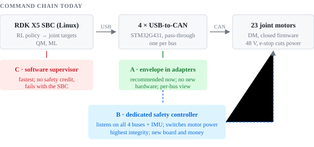

# WP-M-01 Assurance Strategy

| Field | Value |
|---|---|
| Work product | WP-M-01 Assurance strategy and lifecycle tailoring |
| Version | 0.3 (decision batch 2 applied: second channel before the industrial claim (DQ-012 A), zone separation (DQ-013 A), a fall into a clear zone accepted (DQ-014 A), 0.3 m/s with a worker in the cell (DQ-015 A), the lead as acting safety manager (DQ-016 A); 2026-10-28). 0.2 (decision batch 1 applied: industrial work cell use (DQ-001 B), own pinned fork (DQ-002 A), EU first with US (DQ-003 A), integrated analysis (DQ-004 A), all functional-safety families (DQ-005), two-tier stop (DQ-006 A), envelope in the adapters (DQ-007 A), reference configuration (DQ-008 A), development rules (DQ-009 A), no external review (DQ-010 C); 2026-10-26). 0.1 (first draft; 2026-10-26) |
| Status | Draft, I0 (AI-authored, not verified) |
| Author | Claude (AI assistant) |
| Approver | Project lead, acting safety manager (DQ-016 A). Self-approval is a recorded limitation: no work product counts as independently verified |

## 1. Purpose

The assurance path for the RPO humanoid: what we will claim and for which configuration, the architecture that makes
the claim reachable, how the standards are applied ([WP-M-02](WP-M-02-standards-map.md)), the phases and gates, and
what we reuse from LionDriver. The starting point is the [gap assessment](../00-assessment/gap-assessment.md).

## 2. Starting point

- RPO is a 23-joint open-source biped from Roboparty. Its RL policies send joint targets straight to the motors; no
  element in the chain has a safety job (gap assessment F-01…F-09).
- The only stop is a power cut, which makes a balancing robot fall (F-08).
- No requirements, hazard analysis, tests or reviews exist (F-13). The code is a daily snapshot of upstream
  repositories we do not control (F-14).
- The hardware is low-cost COTS: a Linux SBC, four STM32 USB-to-CAN adapters, hobby-grade joint motors with closed
  firmware, a 48 V Li-ion pack.

**Fork policy (DQ-002 A).** `roboto_safety` is our own fork. The assured configuration is a tagged commit of this
repository. Upstream Roboparty changes come in only by a reviewed pull request with an impact analysis; GitHub's
"Sync fork" button and direct subtree pulls into `main` are not used. Changes we make under `modules/` are ours to
carry and may be offered back upstream.

## 3. What we will claim

### 3.1 Reference configuration

| Element | Reference configuration (DQ-008 A) |
|---|---|
| Robot | RPO V2.0 mechanics, 23 DM joint motors on 4 CAN buses, HiPNUC IMU (`robots/rpo/robot.yaml`) |
| Compute | RDK X5 8 GB, the board image built from `roboparty_firmware` at a pinned commit |
| Software | A tagged `roboto_safety` release pinning every module by commit |
| Function | Walking on flat ground under gamepad velocity command, default policy only (`configs/default.yaml`) |
| Intended use (target) | An industrial work cell in which the robot works alongside trained workers (DQ-001 B). Workers and the walking robot are kept in separate zones: the robot stops when a worker enters its zone (DQ-013 A). It walks at up to 0.3 m/s while a worker is in the cell and up to 0.6 m/s when the cell is empty (DQ-015 A) |
| Use during development | Indoors; trained operator on the stop; 2 m exclusion zone; gantry or harness for every untested policy or change; free walking only for a configuration that has passed its gantry tests (DQ-009 A) |

Other policies (parkour, get-up, motion imitation, interrupt), teleoperation and navigation join the claim one at a
time through an impact analysis, as LionDriver adds vehicles.

### 3.2 Top-level claim

G0 and sub-claims H1–H7 are in [WP-M-02 §3.1](WP-M-02-standards-map.md#31-claim-structure), argued for the
industrial work cell of §3.1 under ISO 10218-1/-2:2025 and the ISO 25785-1 draft. No claim is made for use among
untrained people, in homes or public spaces, or outside the work cell.

**Integrity target.** In an industrial cell next to workers, the robot's safety functions are expected to need
ISO 13849-1 PL d (category 3 structure), the default ISO 10218-1 has set for robot safety functions; the exact PLs
come from the 2025 text and our risk assessment at G1. The adapters chosen for the envelope (DQ-007 A) are single
channel on a non-safety MCU and are not expected to reach PL d alone. They carry the envelope during development;
before the industrial claim, at G3, an independent second channel is added (a small safety controller, or a
certified safety relay on motor power with a monitored stop line) so that the pair reaches PL d (DQ-012 A). The
hazard analysis confirms PL d for every safety function with zone separation
([WP-C-03 §5](../02-concept/WP-C-03-integrated-hazard-analysis.md#5-safety-functions-and-required-performance-levels)).

**Safe state and falls (DQ-014 A).** A fall of the robot is an acceptable outcome of a stop or a fault when nobody
is inside the fall zone: a radius of at least the robot's height plus a margin around it while it moves. Damage to
the robot is accepted. Keeping that zone clear is part of the zone separation.

## 4. Safety architecture argument

*Figure 4-1.* The command chain from policy to motors, and the three places the joint envelope could run (DQ-007).

The argument has the same shape as LionDriver's: keep the ML stack QM and SOTIF-managed, and concentrate integrity
work on a small envelope that is the only path to the actuators.

1. **Envelope, in the USB-to-CAN adapter firmware (DQ-007 A).** Per-joint limits, heartbeat timeout, mode gating,
   and a commanded damped state on any fault. The adapters already sit on every bus and run 586 lines of open Zephyr
   code; adding the envelope there costs no new hardware. Each adapter sees one bus, so a whole-body stop needs a
   cross-bus signal (a shared stop line or a broadcast frame), to be designed in the safety concept. Integrity limit:
   see §3.2 and DQ-012.
2. **Stop ladder, two tiers (DQ-006 A).** A soft-stop button lowers the robot to a crouch with damped joints, then
   removes power (IEC 60204-1 category 1). The red button cuts power at once (category 0) and is the last resort; it is
   used with the robot on a gantry or harness as set out in §3.1. A protective stop that keeps balance (category 2)
   is not part of the first concept: with the fall zone kept clear it is not needed (DQ-014 A).
3. **Zone separation (DQ-013 A).** A safety-rated presence sensor around the robot's zone starts the soft stop when
   a worker enters, and tells the robot whether the cell is empty for the speed limit (DQ-015 A). Which sensor to
   buy is a question for the lead.
4. **Freedom from interference.** As on LionDriver, the hinge: the SBC must not be able to reconfigure or bypass the
   envelope (firmware update path, limit tables, mode selection).
5. **Motor assumptions.** The joint motors' own behaviour on CAN timeout and fault becomes an assumption of use that
   is verified by test, since the vendor gives no evidence (gap assessment F-03).

## 5. Phases and gates

| Gate | Exit criterion | Main work products |
|---|---|---|
| **G0 Plan** | Intended use, scope, standards and framework decided; this strategy and the safety plan reviewed | WP-M-01, WP-M-02, safety plan, decision batch 1 answered |
| **G1 Concept** | Integrated hazard analysis done; safety goals; safety concept naming the envelope and stop ladder | Item definition, operating envelope, HATARA, safety concept |
| **G2 Envelope** | Envelope and stop ladder implemented and verified on a bench and on the gantry | Requirements, design, unit and bench tests, motor characterisation |
| **G3 Lab validation** | Walking validated in the lab envelope against targets set at G1; fall and stop tests passed | Validation plan and report, residual-risk argument |
| **G4 Release** | Safety case complete and self-reviewed; no external review or assessment (DQ-010 C), so no claim is presented as independently confirmed | Safety case, internal review records |

**Consequence of DQ-010 C with DQ-001 B and DQ-003 A.** Placing a machine on the EU market under the Machinery
Regulation needs a conformity assessment. If any learned component ensures a safety function, the machine falls in
the Regulation's Annex I Part A and needs a notified body. Keeping the policies outside every safety function (the
envelope pattern of §4) is what keeps that route open; the market route is revisited at G3, the gate DQ-010 names
for revisit.

## 6. Decisions

Batch 1 of the [decision register](decisions/register.yaml), answered by the lead on 2026-10-26:

| Question | Answer |
|---|---|
| What will the robot be used for, and by whom? | Industrial work cell alongside workers (DQ-001 B) |
| Do we assure upstream RPO as-is, or a fork we control? | Our own pinned fork, upstream merged by review (DQ-002 A) |
| Which markets' rules do we design to? | EU first, US alongside (DQ-003 A) |
| One integrated analysis, or a separate track per standard? | Integrated (DQ-004 A) |
| Which functional-safety standard family? | As many as possible: ISO 13849-1, IEC 62061 and IEC 61508, with IEC 61800-5-2 (DQ-005, see [WP-M-02 §2.3](WP-M-02-standards-map.md#23-functional-safety-dq-005)) |
| What should the stop button do? | Two tiers (DQ-006 A) |
| Where does the joint envelope run? | In the USB-to-CAN adapter firmware (DQ-007 A) |
| Which configuration do claims cover? | RPO V2.0, RDK X5, DM motors, default walking policy, gamepad (DQ-008 A) |
| Development-phase operating rules | Gantry or harness for anything untested; 2 m exclusion zone; trained operator (DQ-009 A) |
| Independent assessor | No external review (DQ-010 C) |

Batch 2, answered by the lead on 2026-10-28:

| Question | Answer |
|---|---|
| How should the industrial claim reach PL d, given the envelope runs in the adapters? | Adapters now; an independent second channel before the industrial claim, at G3 (DQ-012 A) |
| How should workers be protected when they share the cell? | Zone separation: the robot stops when a worker enters its zone (DQ-013 A) |
| Is it acceptable for the robot to fall if nobody is within reach? | Yes, if the fall zone is kept clear (DQ-014 A) |
| How fast may the robot walk when a worker is in the cell? | 0.3 m/s with a worker in the cell, 0.6 m/s when empty (DQ-015 A) |
| Who signs off safety work without an external review? | The lead, as acting safety manager; self-approval recorded as a limitation (DQ-016 A) |

Not decided: whether to buy or build the gantry (DQ-017, asked again with a concrete product).

## 7. Reuse from LionDriver

| LionDriver asset | Use here | When |
|---|---|---|
| Decision register, checker, inbox page (`01-management/decisions/`) | Ported as is (this commit) | Now |
| Working agreement (`CLAUDE.md`), AI work as I0, independence rules (WP-M-01 T-09) | Ported | Now |
| HATARA integrated hazard and threat analysis method (`02-concept/hatara`) | Template for H1 | G1 |
| Living Safety Case records, schema and validator (`case/`) | Claims H1–H7 instead of G1–G5 | After G0 |
| Requirements trace tooling and terms registry (`trace/`) | Requirements for envelope and stop ladder | G1–G2 |
| Upstream management (WP-M-11) and impact analysis (WP-M-12) | Roboparty as upstream; every upstream merge is a reviewed PR (DQ-002 A) | G0 |
| STPA control-structure analysis | Gamepad / policy / envelope / motor loops | G1 |
| ISO 26262 ASIL machinery | Replaced by PL or SIL | — |
